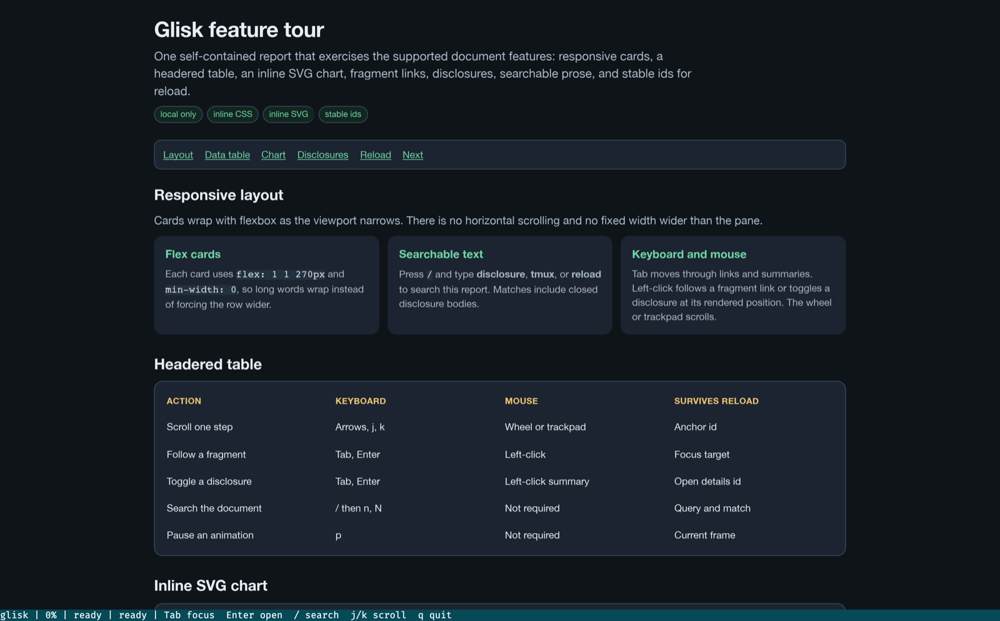
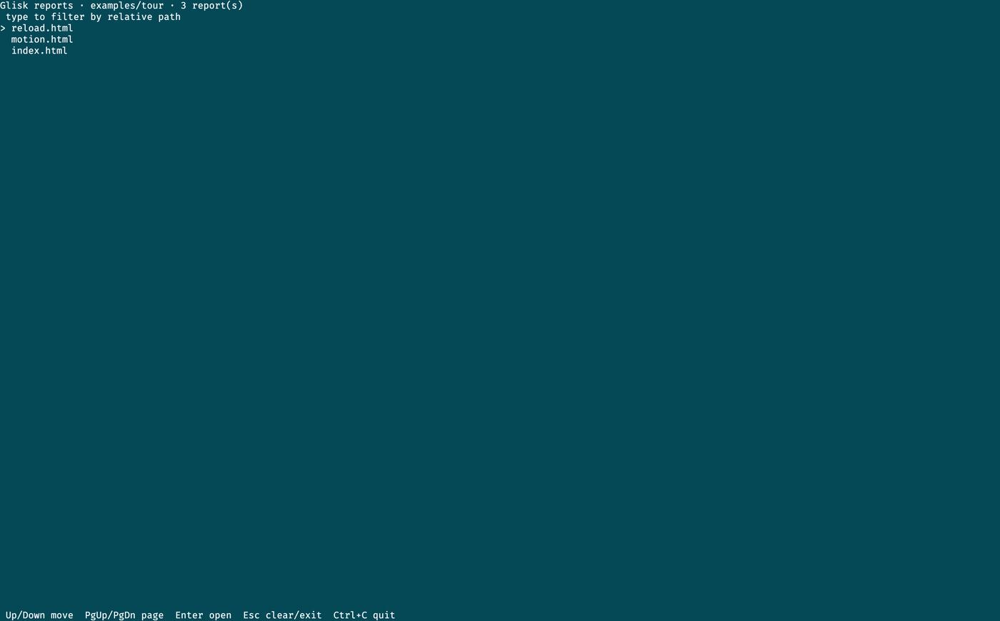
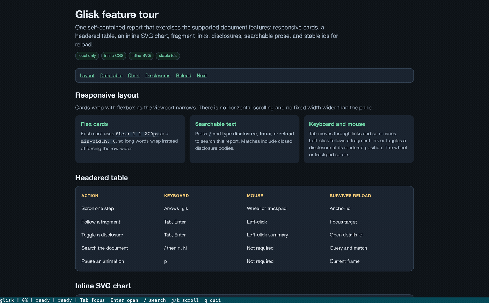
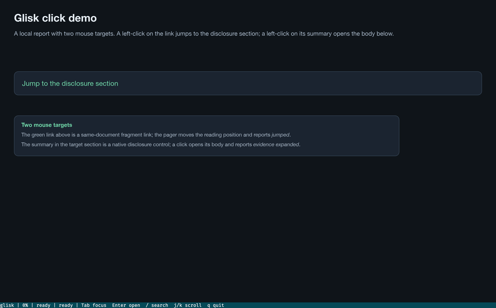
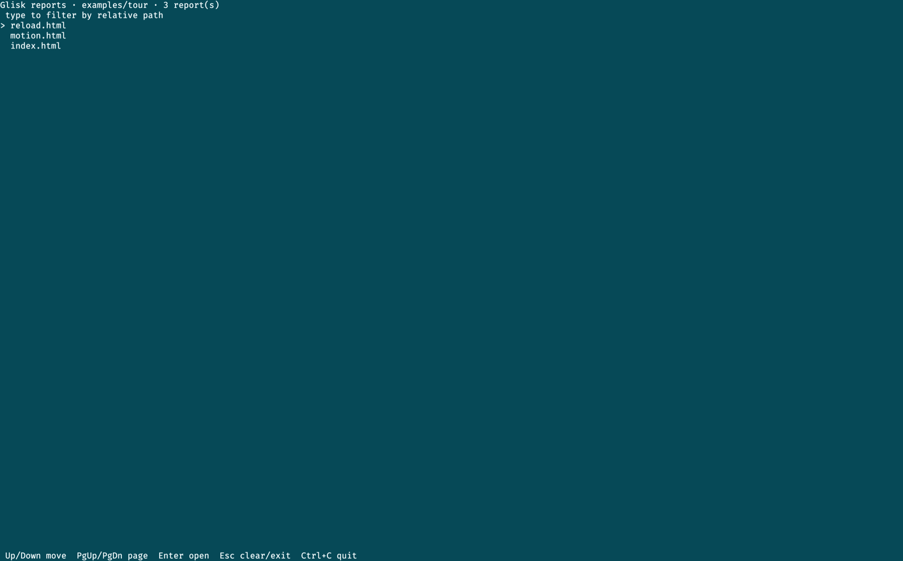
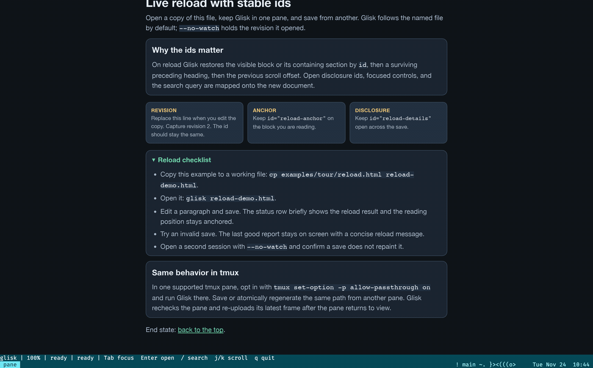

# Glisk

Glisk is a local HTML document pager. It reads one local `.htm`/`.html` file or
stdin and presents it as a live, scrollable terminal view. The verified graphics
target is Ghostty 1.4+ on macOS. Glisk writes plain UTF-8 when graphics are
unavailable, when stdout is redirected, or with `--text`.



*The actual pager rendering [`examples/tour/index.html`](examples/tour/index.html).
The status row stays below the viewport. See
[`docs/assets/README.md`](docs/assets/README.md) for the capture environment and
method.*

## Quick start

```sh
cargo build --release --locked
./target/release/glisk examples/tour            # local report picker
./target/release/glisk examples/tour/index.html # rich report, watched by default
./target/release/glisk examples/tour/index.html --text
cat examples/tour/index.html | ./target/release/glisk -
```

With no positional argument, `glisk` picks a report from the current directory.
`glisk DIR` searches an explicit tree. Type to filter by relative path, use
Up/Down or Page Up/Down, and press Enter to open. Escape from a report returns
to the same filter and selection; `q` or Ctrl+C exits. Hidden files and symlinks
are skipped, and discovery is bounded.

```sh
./target/release/glisk examples/tour --no-watch  # hold the opened revision
```

A named local report is followed by default: save or atomically regenerate it
from another pane and the view reloads without a restart. Reader position
follows stable element `id`s; open disclosures and search survive. A failed
replacement keeps the last good report with an actionable status. Use
`--no-watch` for a snapshot session. Stdin, `--text`, redirected output, and
graphics fallback never watch.

## A short visual tour



*The local picker filters to `motion.html`, opens it, pauses and resumes with
`p`, and returns with Escape. The status row shows the search, animation, and
navigation state.*



*Trackpad scrolling, `/` search, a fragment jump, and a disclosure toggle in
one report. Use Tab and Enter for the same fragment and disclosure actions from
the keyboard.*



*A left-click on a same-document fragment link jumps the reading position (the
status row reports `jumped`); a second left-click on the disclosure summary
opens its body (the status row reports `evidence expanded`). The two SGR
left-press reports come from a deterministic PTY capture, and every frame and
status string is the running pager's own output. Tab and Enter perform the same
two actions from the keyboard.*



*The picker is text-only and rooted at `examples/tour`; filtering narrows the
three reports before Enter opens one in the rich pager.*

The host denied compositor screen capture, so these stills and GIFs are
assembled from the live pager's own frame PNGs and the status text it wrote.
[`docs/assets/README.md`](docs/assets/README.md) records the environment,
method, and regeneration steps.

## Examples

[`examples/tour/`](examples/tour/) is a small, self-contained tour:

- [`tour/index.html`](examples/tour/index.html) — responsive flex cards, a
  headered table, an inline SVG chart, fragment links, disclosures, searchable
  prose, a narrow layout, and reload-stable ids.
- [`tour/motion.html`](examples/tour/motion.html) — CSS keyframes, pause/resume
  with `p`, `--pause-animation`, and a reduced-motion fallback.
- [`tour/reload.html`](examples/tour/reload.html) — stable section and
  disclosure ids for save and atomic-replace reload.

The longer [`decision-report.html`](examples/decision-report.html) remains the
reference report. [`animated-cache.html`](examples/animated-cache.html) is a
compact animation sample. [`examples/README.md`](examples/README.md) lists the
commands and the negative offline fixture.

## tmux

Glisk renders inside one tmux pane when the pane and client pass a read-only
capability check. Opt in per pane; Glisk never changes tmux settings:

```sh
tmux set-option -p allow-passthrough on
./target/release/glisk examples/tour/index.html
```



*Live reload inside a supported tmux pane. The pane-local opt-in is required;
Glisk rechecks the pane and re-uploads its latest frame after the pane returns
to view.*

Requirements for the rich path:

- tmux 3.5 or newer with the pane visible (tested with tmux 3.5a);
- Ghostty 1.4 or newer attached as the client (`TERM=xterm-ghostty`);
- exactly one attached display client for the session, not control mode;
- a truecolor client (Ghostty's terminfo, or
  `set -as terminal-overrides ',xterm-ghostty:Tc'`).

If passthrough is off, the client or geometry is unsupported, or the attachment
is ambiguous, Glisk prints one actionable diagnostic on stderr and falls back to
clean plain text. `--text` and redirected stdout never probe tmux or graphics.
Nested tmux, multiple attached clients, detach/reattach, and remote transports
are outside the initial supported matrix.

## Scope

Glisk is a local document reader, not a browser. It never fetches the network,
reads secondary files, runs scripts, or navigates away from the supplied
document. Author one self-contained file with inline CSS, inline SVG, and
bounded `data:image/png` assets.

## Build and package

Build the macOS bundle from the checked-in pinned lockfile:

```sh
./scripts/package-macos.sh
```

The bundle includes the binary, the tour and reference examples, the authoring
guide, the CLI doc, and checksums.

## Docs

- [`docs/authoring.md`](docs/authoring.md) — supported HTML subset, report skeleton, budgets, and reload ids.
- [`docs/cli.md`](docs/cli.md) — modes, keymap, tmux setup, diagnostics, and tests.
- [`docs/terminal-session.md`](docs/terminal-session.md) — terminal owner, direct Kitty path, and tmux placement.
- [`docs/assets/README.md`](docs/assets/README.md) — capture environment, method, and regeneration notes.
- [`docs/evidence/tmux-ghostty.md`](docs/evidence/tmux-ghostty.md) — live tmux protocol and Ghostty 1.4 evidence.
- [`docs/evidence/watch-reload.md`](docs/evidence/watch-reload.md) — live reload, recovery, opt-out, and tmux workflow evidence.
- [`docs/evidence/picker.md`](docs/evidence/picker.md) — report picker discovery, transitions, and terminal evidence.
- [`docs/release.md`](docs/release.md) — macOS packaging, evidence, and unverified checks.
- [`docs/renderer-spike.md`](docs/renderer-spike.md) — historical renderer measurements.
